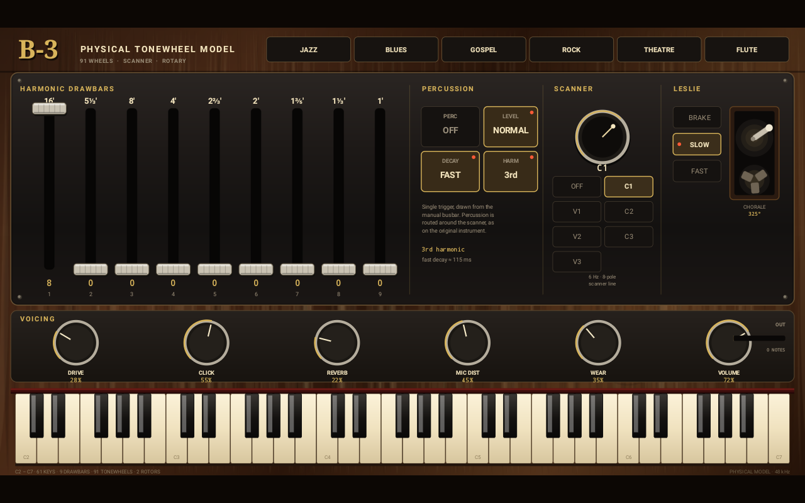

# B-3 Physical

A physically modelled Hammond B-3 tonewheel organ for Android, written in C++17.

There is no sample library. Every note is generated from 91 free-running
tonewheel oscillators wired through the original 61-key harness, then key
click, percussion, scanner vibrato/chorus, a tube preamp and a two-rotor
Leslie cabinet with a stereo microphone pair. The same portable engine runs in
the APK and in the host tests / demo renderer, so the audio you hear is the
audio that was verified.

The repository also contains a complete Android app: a custom-drawn B-3 panel,
a 61-key touch keyboard, MIDI input, low-latency Oboe audio, and GitHub Actions
that run the DSP tests and publish installable APKs.

---

## Highlights

**Generator**
- 91 always-running wheels with 32-bit fixed-point phase: retriggering a key
  never restarts a wheel, exactly like the real generator.
- Per-wheel gain trim, pickup harmonic content, magnetic crosstalk between
  neighbouring wheels, pickup leakage and 60 Hz mains hum in the matching
  transformer.
- Mechanical "wear" control: per-wheel detune and very slow eccentricity drift.

**Harness and keys**
- The real 61-key C2–C7 manual wiring from the Hammond service manual,
  including the duplicated bottom-octave 16' foldback and the asymmetric top
  foldback (see `engine/include/b3/wiring.h`).
- Nine drawbar busses with per-bar pickup taper and a non-linear 0–8 level law.
- Full 61-key polyphony on a shared busbar, with make and break key clicks
  generated by a voice pool and routed through the scanner.

**Percussion**
- Single-triggered 2nd or 3rd harmonic taken from the manual's busbar wiring.
- Fast / slow decay (≈115 ms / 340 ms), normal / soft level.
- Routed around the scanner, as on a B-3; cut when the last key is released.

**Scanner vibrato / chorus**
- 6 Hz, 8-pole scanner over a 0.9 ms delay line with a switching ripple.
- V1–V3 fully wet vibrato and C1–C3 dry/wet chorus, each with its own depth and
  amplitude-modulation amount.

**Preamp**
- Matching-transformer high-pass, asymmetric tube saturation with first-order
  antiderivative anti-aliasing, quiescent-point DC removal.
- Three-band tone network and a drive control with output compensation.

**Leslie cabinet**
- Linkwitz–Riley 4th-order crossover at 800 Hz into separate horn and drum
  paths.
- Physical rotor radii, two microphones with adjustable distance and spread,
  path-length Doppler, directivity amplitude modulation, off-axis HF shadowing,
  three cabinet reflections per path, and rotor inertia (fast acceleration,
  slower coast-down, even slower brake).
- Chorale (≈0.78 Hz) and tremolo (≈6.6 Hz) speeds, plus brake.

**Room and output**
- 8-line feedback delay network with Hadamard mixing, damping, pre-delay and
  size-dependent RT60.
- Expression, master volume, DC blocking and a feed-forward limiter with a
  soft-clip safety net.

**Instrument app**
- Custom-drawn 1800×1000 panel: walnut veneer, brushed metal, chrome drawbars,
  percussion toggles, scanner selector, Leslie switch, six knobs and an
  animated rotor whose angle comes from the engine itself.
- Six registrations: JAZZ, BLUES, GOSPEL, ROCK, THEATRE, FLUTE.
- Multitouch keyboard with glissando, active-key highlighting and C labels.
- State is persisted across launches.
- USB and Bluetooth MIDI input: notes, expression (CC11), channel volume (CC7)
  and mod-wheel rotor speed (CC1).

---

## Signal flow

```
91 tonewheels ─┐
               ├─► busbar + drawbars ─► key clicks ─► scanner ─┐
leakage / hum ─┘                                              │
                                       percussion (bypasses) ─┴─► preamp
                                                                   │
                                                expression ────────┤
                                                                   ▼
                                                   Leslie (mono in, stereo mics)
                                                                   │
                                                            FDN room reverb
                                                                   │
                                                      master + limiter ─► stereo
```

The native chain lives in `engine/src/organ.cpp`; every block is 16 samples
internally so modulation, gains and rotor geometry update smoothly while the
public callback can use any buffer size.

---

## Build

### Host tests and demo (no Android tools required)

```bash
cmake -S . -B build -DCMAKE_BUILD_TYPE=Release
cmake --build build --parallel
ctest --test-dir build --output-on-failure
./build/b3_render b3_demo.wav
```

`b3_tests` checks tuning, the service-manual wiring and foldback, drawbar pitch,
silence/leakage, percussion decay, the scanner, rotor inertia, extreme
registrations, release behaviour and CPU cost. `b3_render` writes a 30-second
performance to `b3_demo.wav`.

### APK

Requirements: JDK 17, Android SDK platform 34, build-tools 34.0.0, NDK
26.1.10909125, CMake 3.22.1. Oboe is resolved from Maven Central.

```bash
export ANDROID_HOME=/path/to/android-sdk
export ANDROID_SDK_ROOT=$ANDROID_HOME

./gradlew :app:assembleDebug      # debug-signed, installable
./gradlew :app:assembleRelease    # also debug-key signed, installable

adb install -r app/build/outputs/apk/debug/app-debug.apk
```

The APK targets `arm64-v8a`, `armeabi-v7a` and `x86_64`; `minSdk` is 26. The
audio stream requests 48 kHz stereo float with low-latency/exclusive mode and
falls back to shared mode if the device refuses exclusive low-latency output;
the callback can render either float or 16-bit stream buffers.

### GitHub Actions

`.github/workflows/android.yml` runs on every push, pull request and manual
dispatch:1. **Native engine tests + demo** — CMake build, `ctest`, demo render,
   WAV sanity analysis, artifact `b3-demo-wav`.
2. **Android APK** — installs SDK/NDK/CMake, builds debug and release APKs,
   verifies the package with `aapt` and checks the native libraries and
   `classes.dex` are present, artifact `b3-physical-apk`.
3. **Emulator smoke** — boots an API 30 x86_64 emulator, installs the debug
   APK, launches the activity, verifies the custom panel draw, injects a C3
   hold, and asserts the JNI `noteOn 48` plus non-silent Oboe output. Uploads
   `emulator-smoke-evidence` (screenshot and filtered logcat).
4. On a `v*` tag the two APKs are attached to the GitHub release.

---

## Controls

| Control | Behaviour |
| --- | --- |
| Nine drawbars | Drag vertically; 0–8 in the original harmonic order 16', 5⅓', 8', 4', 2⅔', 2', 1⅗', 1⅓', 1'. |
| PERCUSSION | `PERC` on/off, `LEVEL` soft/normal, `DECAY` fast/slow, `HARM` 3rd/2nd. |
| SCANNER | `OFF`, vibrato `V1`–`V3`, chorus `C1`–`C3`. |
| LESLIE | `BRAKE`, `SLOW` (chorale), `FAST` (tremolo). The cabinet graphic follows the rotor angle in real time. |
| DRIVE | Tube preamp gain/saturation. |
| CLICK | Key-click amount on make and break. |
| REVERB | Room send. |
| MIC DIST | Leslie microphone distance; farther mics are darker and less direct. |
| WEAR | Generator condition: trim spread and drift. |
| VOLUME | Master level. |
| Preset chips | Six starting registrations. |
| Keyboard | C2–C7, multitouch, glissando, no velocity (an organ has none). |

Default registration is 888000000 with chorus C1, slow rotor and percussion
off.

---

## Repository layout

```
engine/                 Portable C++17 organ engine (no Android dependencies)
  include/b3/           Public API, musical model, service-manual wiring table
  src/                  Tonewheel bank, scanner, percussion, preamp, Leslie,
                        reverb, top-level organ
app/                    Android app (Java UI + JNI + Oboe)
  src/main/java/        MainActivity, OrganView, parameters, MIDI, engine facade
  src/main/cpp/         JNI bridge and Oboe stream
tools/                  Host tests, demo renderer and emulator smoke test
docs/DSP.md             Equations and implementation notes
.github/workflows/      CI: engine tests, demo, APK build/release
```

---

## Verification

On the development machine used for this repository:

* `b3_tests`: **1,144 checks, 0 failures**; measured **≈25× realtime** for a
  six-note registration at 48 kHz on two cores.
* Demo: 30.6 s stereo, peak 0.576, RMS 0.085, with the expected C-major chord
  partials present.
* APK build: both debug and release APKs compiled locally with NDK r26b
  (4.7 MB each), containing `arm64-v8a`, `armeabi-v7a` and `x86_64` native
  libraries, `liboboe.so`, `classes.dex`, and all nine `native*` JNI exports.
  The release APK verifies with `apksigner` and is debug-key signed so it can
  be sideloaded; use your own key for store distribution.
* CI repeats the entire build in a clean environment and uploads the APKs.

### Emulator execution evidence

The debug APK was installed and launched on a headless Android 11 (API 30)
x86_64 emulator (4 vCPU, 3 GB, software GPU, `-accel off` because this host's
`/dev/kvm` is unavailable). This is an actual Android runtime, not a host-side
mock:

* `B3Ui` reported `panel drawn 1280x800`; the committed screenshot
  [`docs/emulator-panel.png`](docs/emulator-panel.png) is the emulator
  framebuffer.
* A synthesized C3 hold at the keyboard's C3 position logged
  `touch down at 395.15625,899.37494`, then `noteOn 48 velocity 1.000` and
  `noteOff 48` in the JNI layer.
* Oboe opened an AAudio stream at 48 kHz, 2 channels, `audio stream started`,
  and `B3Audio` measured `level peak=0.0476` while the key was tapped, versus
  roughly `0.002` from the idle hum/leakage bed. The native output is not
  silent.
* The app process remained alive before and after the interaction.

The permanent `tools/emulator_smoke.sh` repeats these checks and completed
with `SMOKE: PASS: 1280x800 panel, C3 at 281,684, screenshot 198002 bytes`.
The `emulator-smoke` GitHub Actions job uses
`reactivecircus/android-emulator-runner` with an API 30 x86_64 image and KVM,
uploads the screenshot and filtered logcat, and fails on a missing panel,
missing `noteOn 48`, a silent or absent audio callback, a truncated screenshot,
or an app crash/ANR.



What was **not** proven here: real touchscreen feel and latency (input was
injected with `adb shell input`), hardware audio output latency (the emulator's
AAudio path was exercised), USB/Bluetooth MIDI hardware (no devices were
attached), or installation on a physical phone. The slow unaccelerated
emulator's system UI produced ANR dialogs during boot; the app's own process and
audio stayed healthy, and the evidence above is from the app. See `docs/DSP.md`
and `docs/emulator-evidence.txt`.

---

## Notes and credits

* The manual-to-wheel wiring table follows the standard Hammond service-manual
  chart (as published at <https://www.dairiki.org/hammond/wiring>); it is
  factual wiring data, not sampled audio.
* Wheel frequencies are equal-tempered with per-wheel mechanical trim rather
  than a tooth-by-tooth gear model.
* Not affiliated with Hammond Suzuki or Arturia. The B-3 is a Hammond trademark;
  this is an independent physical-model implementation.
